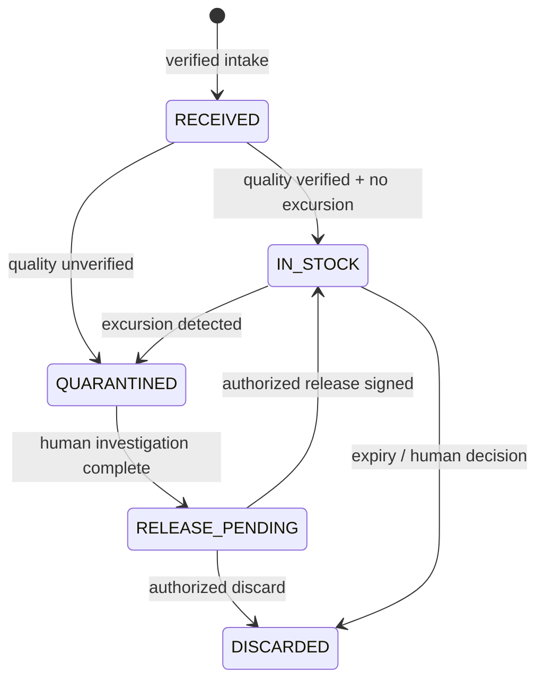

# DATA_QUALITY_AND_INTEROPERABILITY.md — HemoNexus

**Phase 0.1 document. No application code changed. Access date: 2026-11-26.**
**Evidence legend:** [VERIFIED] · [PARTIALLY VERIFIED] · [ASSUMPTION] · [PROPOSED] · [SIMULATED].

---

## 1. Why a separate Data Trust engine

A forecast is only as good as its inputs, and a coordinator must be able to tell whether a stock figure is fresh, verified, and complete. HemoNexus therefore separates three concepts that dashboards often conflate:

| Concept | Owned by | Meaning | Never used as |
|---|---|---|---|
| **Data quality / freshness** | Data Trust engine | How recent, complete, verified and consistent the *inputs* are | Forecast confidence |
| **Forecast uncertainty** | Intelligence service | Prediction interval from backtest residuals | Data quality |
| **Shortage risk band** | Score engine | CRITICAL/HIGH/MODERATE/STABLE from factors | Clinical suitability |

These are stored in different fields and rendered by different UI components (`UI_UX_STRATEGY.md` §9.1). Multiplying them into one "trust score" is explicitly forbidden.

---

## 2. Data Trust engine [PROPOSED]

### 2.1 Tracked dimensions per institution/source

| Dimension | Field | Rule |
|---|---|---|
| Last inventory update | `last_update_at` | Timestamp of last accepted, verified event |
| Source institution | `source_institution_id`, `source_system` | Recorded for every row; never inferred |
| Verification status | `verification_state` ∈ `UNVERIFIED / VERIFIED / REJECTED` | Set only by an authorized human or a verified feed |
| Missing data | `missing_fields[]` | Required fields absent (expiry, storage condition, group…) |
| Conflicting records | `conflicts[]` | Duplicate natural keys, contradictory quantities, expiry before collection |
| Stale inventory | `stale_flag`, `stale_after_hours` | Configurable per institution type; default 24h **[ASSUMPTION]** |
| Completeness | `completeness_pct` | Present required fields / expected required fields |
| Data mode | `is_simulated`, `source_label` | Always `true` / `SIMULATED` in this build |

### 2.2 Freshness indicator (transparent, not a score)
`FreshnessPill` shows one of:
- `UPDATED <n> MIN AGO` (green) — within threshold
- `AGING — <n> H AGO` (amber) — within 2× threshold
- `STALE — <n> D AGO` (red) — beyond threshold, excluded from scoring

Exact timestamp and source are always available on focus/hover. Completeness is shown separately as `CompletenessMeter`. No opaque 0–100 "trust score" is displayed.

### 2.3 Gates into the forecasting pipeline

```
Ingest → validate (Zod/Pydantic) → trust evaluation → gates
  ├─ verification_state == REJECTED            → block scoring, alert source
  ├─ stale_flag && age > 2× threshold          → block scoring, show STALE
  ├─ unresolved conflict                       → block scoring, require review
  └─ completeness_pct < 85%                    → score with explicit DEGRADED flag
```

When scoring is blocked, the UI shows observed history only and the API returns `{ "status": "INSUFFICIENT_DATA" | "DATA_QUALITY_BLOCK", ... }` — never a fabricated number (`AI_ML_STRATEGY.md` §10.2).

### 2.4 Data quality tests [PROPOSED]
- Inject a stale source → assert no new `risk_score` row is written.
- Inject a conflicting duplicate → assert conflict recorded and scoring blocked.
- Drop required fields → assert `missing_fields` populated and completeness recomputed.
- Mark unit quarantine/excursion → assert it disappears from `eligible_for_matching`.
- Assert freshness indicator text matches the underlying timestamp for each band.

---

## 3. Interoperability: FHIR R5 (research findings)

### 3.1 [VERIFIED] InventoryItem — HL7 FHIR R5
- **Source:** `https://hl7.org/fhir/R5/inventoryitem.html`, section **12.30**, "FHIR v5.0.0: R5 — STU", generated **Sun, Mar 26, 2023**.
- **Maturity:** Level 0 **Draft**, business security category; implementer note warns the resource *"is intended to satisfy a narrow set of use cases… Without implementation feedback, this resource may be removed in future releases."*
- **Scope (§12.30.1):** defines characteristics of a material item for logistics; *"NOT intended … in clinical workflows, where the specific product resources shall be used"*; corresponds roughly to "product/material" in ERP systems.
- **Relevant elements (§12.30.4):** `identifier`, `status` (`active|inactive|entered-in-error|unknown`), `category`, `code`, `inventoryStatus` (usage status such as recalled/in use/discarded), `baseUnit`, `netContent`, `characteristic[]` (`characteristicType` + `value[x]`), `instance` (`identifier`, `lotNumber`, `expiry`, `subject`, `location`), `productReference` (Medication/Device/NutritionProduct/BiologicallyDerivedProduct).
- **Boundaries (§12.30.2):** referenced by InventoryReport, Transport, SupplyRequest, SupplyDelivery, ServiceRequest.
- **Search params (§12.30.5):** `code`, `identifier`, `status`, `subject`.

### 3.2 [VERIFIED] InventoryReport — HL7 FHIR R5
- **Source:** `https://hl7.org/fhir/R5/inventoryreport.html`, section **12.29**, same R5 publication date (26 Mar 2023), Maturity Level 0 **Trial Use**.
- **Scope (§12.29.1):** lists current status as a **snapshot** or changes as **difference** (additions/subtractions); can be scheduled or ad-hoc.
- **Relevant elements (§12.29.4):** `identifier`, `status` (`draft|requested|active|entered-in-error`), `countType` (`snapshot|difference`), `operationType` (addition/subtraction), `operationTypeReason`, `reportedDateTime` (required), `reporter`, `reportingPeriod`, `inventoryListing[]` with `location`, `itemStatus`, `countingDateTime`, `item[]` (`category`, `quantity` required, `item` CodeableReference), `note[]`.
- **Boundary (§12.29.2):** explicitly *"does not overlap with Dispense"* — Dispense carries clinical meaning; InventoryReport carries logistics. This matches HemoNexus's non-clinical role.

### 3.3 [PROPOSED] Mapping subset — do not implement all of FHIR

| HemoNexus concept | FHIR R5 target | Mapping note |
|---|---|---|
| Blood unit | `InventoryItem.instance` (`identifier`, `lotNumber`, `expiry`, `location`) + `InventoryItem.code` | One FHIR InventoryItem per unit type; instance carries unit identity |
| Component / group | `InventoryItem.code`, `category`, `characteristic[]` | Use coded concepts; group/component as characteristics |
| Availability / reservation | `InventoryItem.inventoryStatus` | Map to local eligibility/status codes |
| Storage rule | `InventoryItem.characteristic` (`valueCodeableConcept`/`valueString`) | Carrier only; authoritative rule stays in local versioned table |
| Stock snapshot | `InventoryReport.countType = snapshot`, `inventoryListing.item.quantity` | Per institution/location |
| Stock delta event | `InventoryReport.countType = difference`, `operationType` addition/subtraction | Matches HemoNexus event-sourcing style |
| Count time / source | `countingDateTime`, `reportedDateTime`, `reporter`, `note` | Supports Data Trust provenance |

**Deliberately not implemented in v1:** full FHIR server, Terminology server, `Transport`, `SupplyRequest`, `SupplyDelivery`, Dispense, Patient/Practitioner resources, and bulk data operations. The mapping is a documented adapter with unit tests, not a runtime requirement.

### 3.4 [PROPOSED] Future e-RaktKosh / institutional integration

```
Source system (e-RaktKosh feed or institution API) [ASSUMPTION — no open API verified]
        → authorized gateway (credentials, rate limits, purpose check)
        → validate + provenance (Data Trust engine)
        → map to FHIR-shaped internal DTO (§3.3)
        → domain events (consumption, stock delta, donation)
        → forecast + score + map
```

Prerequisites before any real feed: formal authorization, data dictionary, verification of institution identity, DPDP/lawful-basis review, and explicit labelling that removes `[SIMULATED]`. Until then, every entity is **SIMULATED**.

---

## 4. Traceability and audit [PROPOSED]

- Every trust evaluation records inputs, decision (allow/block/degrade), timestamp, and version of the rules used.
- Every FHIR-shaped export records mapping version and source data version.
- Audit rows are append-only; no UI or API deletes them.
- Data Trust indicators and forecast intervals are never combined in a single exported column.

---

## 5. Research register for this document

| Ref | Source | Date/section | Verification |
|---|---|---|---|
| R1 | HL7 FHIR R5 InventoryItem | 26 Mar 2023, §§12.30.1–12.30.5 | [VERIFIED] fetched |
| R2 | HL7 FHIR R5 InventoryReport | 26 Mar 2023, §§12.29.1–12.29.5 | [VERIFIED] fetched |
| R3 | e-RaktKosh public portal | accessed 26 Nov 2026, "Blood Availability Search", "Types of donation" | [VERIFIED] fetched |
| R4 | WHO blood cold chain / fact sheet | 12 Jun 2026 fact sheet; cold-chain page | [VERIFIED] fetched |
| R5 | National Standards for Blood Centres | hosted 2022-07 | [PARTIALLY VERIFIED] PDF not parseable here |

---

## 6. Independent measurability of Data Trust dimensions [PROPOSED]

Each dimension is computed by its own function, stored in its own column, and has its own test. Dimensions are **not** aggregated into one score and are **never** multiplied into forecast confidence.

| Dimension | Independent measure | Unit / threshold | Test |
|---|---|---|---|
| Last update | `age_hours = now() − last_update_at` | hours; fresh ≤24, aging ≤48, stale >48 **[ASSUMPTION]** | T4 boundary test |
| Source institution | `source_institution_id` non-null and resolvable | boolean | Fixture with missing source → blocked |
| Verification status | enum `UNVERIFIED/VERIFIED/REJECTED` | categorical | T3; only authorized role can set VERIFIED |
| Missing data | `missing_fields.length` | count of required fields | T5 field-drop test |
| Conflicting records | `conflicts.length` | count of unresolved conflicts | T2 duplicate test |
| Stale inventory | `stale_flag` derived from `age_hours` | boolean | T1 stale-source test |
| Completeness | `completeness_pct = present_required/expected_required` | percent, 0–100 | T5 recompute test |
| Data mode | `is_simulated` | boolean | Assert true for every demo row |

**Independence assertion:** changing one dimension must not change another. Example: making a source stale must not alter its `completeness_pct`; lowering completeness must not alter `verification_state`. A unit test asserts this matrix.

---

## 7. Cold-chain quarantine and release workflow [PROPOSED]



Rules:
- `QUARANTINED`, `RELEASE_PENDING`, and `DISCARDED` units are absent from `eligible_for_matching` and from all "available stock" views.
- Transition `RELEASE_PENDING → IN_STOCK` requires an **authorized human quality officer**, a recorded reason, a timestamp, and an audit entry. AI has no transition permission.
- Triggering events (`excursion_event`, `quality_verification`) may be recorded by a verified device or authorized user; they never auto-release a unit.
- Every transition is append-only audited with actor, before/after state, and reason.
- UI badge states are textual + color + icon; no state relies on color alone.

Tests: U2/U3 (eligibility), plus new Q1–Q4 (no AI release; unauthorized role denied; release requires reason; audit entry written).
