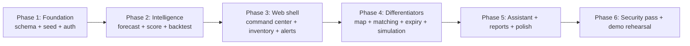

# IMPLEMENTATION_PLAN.md — HemoNexus

**Status:** Proposed sequence only. **No implementation has started** and none should start until this plan is approved and the agent is switched out of plan mode.

---

## 0. Pre-flight decisions (before writing code)

1. Confirm the workspace location — `Promptwars offline` is currently empty. Decide whether to build there or in a new repo.
2. Choose domain API: **Express + TypeScript** (fastest) or **NestJS** (stronger guards). Pick one.
3. Choose real-time transport: SSE (simpler) or Socket.IO (familiar). Pick one.
4. Confirm managed Postgres with PostGIS for preview/production.
5. Approve the synthetic-data policy in `DATA_STRATEGY.md` — this is the demo's foundation.

---

## 1. Phase order and dependencies

Phases are sequential in dependency, but Phase 3 UI can start against mocked API responses as soon as Phase 1 contracts are frozen.

---

## Phase 1 — Foundation (P0-1, P0-2, P0-3)

**Goal:** a clean checkout can create a deterministic synthetic world and authenticate into it.

| Step | Work | Done when |
|---|---|---|
| 1.1 | Scaffold monorepo: `apps/web`, `apps/api`, `services/intelligence`, `packages/shared` (enums/RBAC/band thresholds) | `npm run dev` starts all three locally |
| 1.2 | Prisma schema + PostGIS migration from `SYSTEM_ARCHITECTURE.md` §5 | Migration applies cleanly on fresh DB |
| 1.3 | Seeded synthetic generator + district seed data | `npm run seed` produces identical data twice from the same seed |
| 1.4 | Auth: argon2/bcrypt hashing, httpOnly JWT, refresh rotation | Login works; tampered cookie rejected |
| 1.5 | RBAC guards + institution scope + RLS policies | Cross-institution read returns 403; audit entry written |
| 1.6 | Inventory intake (CSV + form) with Zod validation | Invalid rows rejected with reasons; valid rows update stock view |

**Tests:** schema constraints, RBAC matrix unit test, RLS integration test with two institutions, generator determinism assertion.

---

## Phase 2 — Intelligence core (P0-4, P0-5, P1-6)

**Goal:** real numbers, reproducible evidence.

| Step | Work | Done when |
|---|---|---|
| 2.1 | Python FastAPI service skeleton + Pydantic contracts | `/health` and `/forecast` respond with typed payloads |
| 2.2 | Seasonal naive + ETS/STL forecaster | Forecasts produced for all aggregate series |
| 2.3 | Rolling-origin backtest job → `backtest_report.csv` | Challenger beats baseline on WAPE or baseline is retained with a note |
| 2.4 | Intelligence score engine with factors, weights version, hard override | Every score includes factor payload and is reproducible |
| 2.5 | Alert generation on band transitions (dedup) | Seeded event produces alerts with reasons |
| 2.6 | Backtest/evidence page data endpoint | Metrics and detection lead time served to UI |

**Tests:** score math unit tests (known inputs → known band), override test, backtest reproducibility assertion, seeded-event detection lead time assertion (≥5 days target).

---

## Phase 3 — Web shell (P0-6, P0-7, P0-8, P0-9)

**Goal:** usable command center with honest data display.

- App shell, design tokens, navigation, `DataModeBanner`, timestamp component.
- Overview command center, institution/hospital/blood-bank role variants.
- Inventory + expiry table, alerts centre, audit viewer (admin).
- All screens labelled `SIMULATED DATA`; stale-data banner.

**Tests:** component tests for band display (text + color), keyboard navigation pass, role-based action visibility.

---

## Phase 4 — Differentiators (P1-1 … P1-4)

- MapLibre + PostGIS layers, hotspot + nearby surplus panel, list alternative.
- Matching engine with compatibility rules, transport-time ranking, authorization gates.
- Expiry intelligence views linked to matching.
- Simulation engine: scenario builder, cloned-state computation, side-by-side comparison, watermark, separate storage.

**Tests:** compatibility matrix exhaustive test, distance-query test, simulation-purity test (assert no writes to inventory tables), scenario validation tests.

---

## Phase 5 — Assistant, reports, polish (P1-5, P2-6, P2-7)

- Read-only grounded tool endpoints; assistant with source citations and refusal states.
- Scripted 10-question demo set with expected grounded facts.
- Reports/exports with watermark; theme and reduced-motion support.

**Tests:** numeric-token grounding check on scripted answers, tool allowlist test (no write tools), export watermark test.

---

## Phase 6 — Hardening and demo (security + reliability)

- Full RBAC/RLS sweep, secret scan, dependency audit, CORS/env cleanup.
- Accessibility pass (keyboard + contrast + screen reader on core screens).
- Clean-clone runbook and 8-minute demo script with fallback static data if a service fails.
- Final scorecard re-assessment against `HACKATHON_SCORECARD.md`.

---

## 2. Testing strategy

| Level | Tooling (proposed) | Coverage |
|---|---|---|
| Unit | Vitest (TS), pytest (Python) | Score math, compatibility rules, validation schemas, generator determinism |
| Integration | Supertest + test Postgres with RLS | Auth flows, institution isolation, inventory mutations, transfer state machine |
| Backtest assertion | pytest + committed fixture | Model beats baseline; detection lead time; reproducible metrics |
| API contract | Zod/Pydantic schema tests | Unknown fields rejected, enum enforcement |
| Security | Manual matrix + automated role tests | Every role × every endpoint expectation |
| Accessibility | Axe + manual keyboard pass | Core screens AA; reduced motion |
| Demo smoke | Playwright script | Full workflow A→D from clean seed |

**Rule from ponytail mode:** every new non-trivial branch/loop/parser gets at least one assert-based check. Trivial wiring does not.

---

## 3. Acceptance criteria for the whole project

1. A fresh clone + one documented command sequence produces the full demo with synthetic data.
2. No hardcoded IPs, no committed secrets, no real institution names.
3. Every score, forecast, export, and assistant answer shows data mode and as-of time.
4. Every CRITICAL/HIGH score shows ≥4 factor contributions.
5. Simulation cannot alter inventory; comparison labels are explicit.
6. Cross-institution access is denied and audited.
7. Backtest report exists and shows the chosen model vs baseline.
8. Transfer requests require both institutional approvals and clinical sign-off.
9. Keyboard-only demo possible on overview, inventory, simulation, and assistant.
10. Scorecard re-assessed honestly; no planned-but-unbuilt feature counted.

---

## 4. Risk register

| Risk | Likelihood | Impact | Mitigation |
|---|---|---|---|
| Empty workspace / wrong repo location | High (already happened) | High | Confirm path in pre-flight (0.1) |
| No real data → credibility gap | Certain | Medium-High | Explicit synthetic labelling + backtest evidence + onboarding path |
| Forecast does not beat baseline | Medium | High | Ship baseline; report honestly; use detection lead time as headline |
| LLM leaks fabricated numbers | Medium | High | Numeric-token grounding validation; no write tools |
| Cross-institution leak | Medium | High | RLS + role tests + audit |
| Scope creep into mobile app | Medium | Medium | Explicitly out of scope in all docs |
| Time pressure cuts simulation polish | Medium | High | Build simulation before assistant; it is the stronger differentiator |

---

## 5. What is deliberately skipped

- No production deployment or push during this phase.
- No real hospital onboarding.
- No mobile app, blockchain, or microservice sprawl.
- No deep-learning models until classical baselines are proven.

---

## 6. Phase 0.1 — revised sequencing and acceptance

The phase order stays, but the following work is inserted:

| Insert into phase | Added work | Acceptance criterion |
|---|---|---|
| Phase 1 | Unit-level `blood_unit`, temperature/excursion, quarantine/quality, and `data_trust_record` tables; component rule table | Schema enforces unique unit IDs and eligibility gating; generator emits all new fields |
| Phase 2 | Data Trust pipeline before scoring; MASE/bias/coverage/event metrics; insufficient-data state; versioning and drift fields | Scores never computed from failed verification gates; backtest report contains all §10.1 metrics |
| Phase 3 | Freshness/quality UI, approvals screen, cold-chain views | Ineligible units never shown as available; approval requires human identity |
| Phase 4 | Reservation transactions + idempotency + expiry jobs; transfer feasibility engine; isolated simulation | Concurrency test passes; simulation writes zero production rows |
| Phase 5 | FHIR-ready mapping tests; DPDP retention/incident runbook | Mapping unit tests pass; runbook reviewed |
| Phase 6 | Demo script per `DEMO_AND_EVALUATION_PLAN.md` | All 9 demo steps pass from clean seed |

Full test design: `TESTING_AND_VALIDATION_STRATEGY.md`. Demo criteria: `DEMO_AND_EVALUATION_PLAN.md`.

---

## 7. Updated risk register (Phase 0.1)

| Risk | Likelihood | Impact | Mitigation | Owner |
|---|---|---|---|---|
| Workspace empty / wrong repo path | High (occurred) | High | Confirm path in pre-flight 0.1 | Team lead |
| No real data → credibility gap | Certain | Medium-High | Synthetic labelling + backtest evidence + e-RaktKosh complementarity framing | Product |
| Forecast fails to beat baseline | Medium | High | Ship baseline; report honestly; lead time as headline | ML |
| LLM invents numbers | Medium | High | Grounding validation; no write tools; no numeric generation | Engineering |
| **Unit double-allocation** | Medium | **High** | Row-lock transaction + idempotency + reservation expiry + concurrency test | Engineering |
| **Unresolved excursion shown as available** | Medium | **High** | Eligibility gate in materialized view; UI badges; negative tests | Engineering |
| Cross-institution leak | Medium | High | RLS + role matrix tests + audit | Security |
| Simulation mutates live stock | Low-Medium | High | Isolated tables + automated purity assertion | Engineering |
| DPDP misstatement (phased dates) | Medium | Medium | Cite gazette; mark unverified items; no legal claims in demo | Product |
| Scope creep / time pressure | Medium | High | Build simulation before assistant; defer P2 | Team lead |

---

## 8. Final implementation readiness checklist

- [ ] Official name is **HemoNexus** everywhere; original problem statement preserved.
- [ ] Pre-flight decisions in `SYSTEM_ARCHITECTURE.md` §8 accepted (Express monolith, Python service, SSE, Redis/BullMQ, PostGIS).
- [ ] Component shelf-life/storage rules sourced and versioned; values labelled verified vs unverified.
- [ ] Synthetic generator emits unit-level, cold-chain, quality, and trust fields with `SIMULATED` labels.
- [ ] Data Trust gates block scoring from stale/unverified/conflicting sources.
- [ ] Forecast API returns explicit `INSUFFICIENT_DATA` when minimums are not met.
- [ ] Backtest report contains MAE, WAPE, MASE, bias, interval coverage, event precision/recall, lead time, false alarms, missed events; no MAPE-on-zeros.
- [ ] Reservation transaction and concurrency test pass; idempotency and expiry verified.
- [ ] Transfer feasibility emits blockers; clinical sign-off is human-only.
- [ ] Simulation isolation assertion passes; watermark present.
- [ ] FHIR R5 mapping subset documented and tested; no full FHIR server.
- [ ] DPDP controls mapped; phased commencement cited and unverified primary sources flagged.
- [ ] Testing, demo, and final review documents approved.
- [ ] Agent switched out of plan mode before any code is written.

---

## 9. Migration, backup/DR and contract work inserted into phases

| Phase | Added task | Acceptance |
|---|---|---|
| Phase 1 | Prisma migration policy, pre-migration snapshot procedure, migration audit fields | M1/M2/M3 tests pass on preview |
| Phase 1 | Deterministic generator spec: `seed=42`, PRNG version, stable ordering, row hashes | E0 passes; two runs produce identical hashes |
| Phase 2 | Per-scenario insufficient-data states (§11 matrix) | Each state returns typed response; no invented numbers |
| Phase 2 | API contracts Next.js↔Express↔FastAPI | C1/C2/C3 pass |
| Phase 3 | Cold-chain quarantine/release states + human-only release | Q1–Q4 pass |
| Phase 4 | DR failure modes (DB/FastAPI/Redis down) | D1–D3 pass |
| Phase 6 | Backup/restore drill + E2E emergency scenario | D4/B1 and E0–E9 pass |

See `TESTING_AND_VALIDATION_STRATEGY.md` §6–7. Full per-P0 coverage matrix is in `IMPLEMENTATION_READINESS_GATE.md`.
