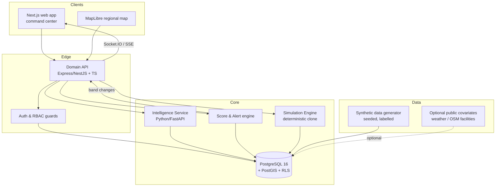
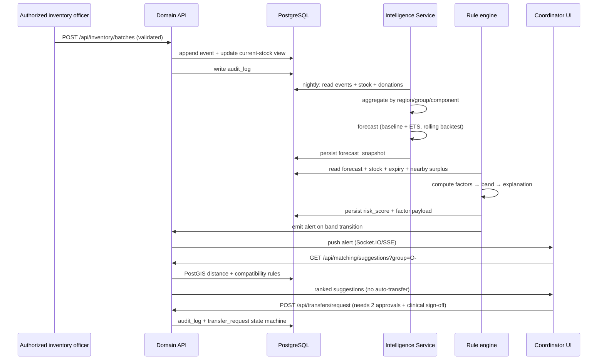
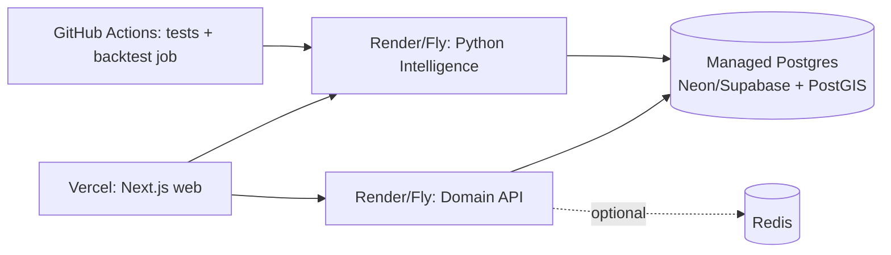

# SYSTEM_ARCHITECTURE.md — HemoNexus

**Status:** Proposed target architecture for a greenfield build. No existing production infrastructure was found or modified (see `PROJECT_AUDIT.md`).

---

## 1. Architecture principles

1. **Preserve team strengths, not foreign frameworks.** The team has already shipped Next.js 15 + Tailwind v4, NestJS/Prisma/PostgreSQL, and Socket.IO in sibling projects. The target stack reuses those conventions. Nothing is chosen for novelty.
2. **Numbers and words are separate services.** Deterministic forecasting lives in Python; the web/API layer is TypeScript; LLMs only phrase explanations.
3. **Institution isolation is enforced in three places** — API scope, Postgres RLS, and UI context — not just one.
4. **Simulation never touches production state.**
5. **Everything auditable.** Mutations and score computations are logged.

---

## 2. Technology choices

| Layer | Choice | Rationale / alternative considered |
|---|---|---|
| Web frontend | **Next.js 15 App Router + TypeScript + Tailwind v4** | Already used successfully by the team (AirAware). Server components for data-heavy pages, client islands for maps/charts. |
| UI components | shadcn-style local components (Radix primitives) | Consistent, accessible, no vendor lock-in; matches sibling project pattern. |
| Charts | Recharts | Declarative, accessible-enough, good table/bar/line coverage. |
| Map | **MapLibre GL JS** + PostGIS | Open-source, no API key; supports vector layers for hotspots and transfer arcs. Leaflet is a simpler fallback. |
| Domain API | **Express 4 + TypeScript, modular monolith** — FINAL DECISION | One deployable API with bounded modules (auth, institutions, inventory, trust, intelligence-client, transfer, simulation, audit). Team familiarity and lowest operational cost; avoids microservice theatre. NestJS was considered but rejected: its extra ceremony adds little for a single deployable domain API. See §8. |
| Database | **PostgreSQL 16 + PostGIS**, accessed via **Prisma** | Prisma/NestJS experience exists in SIH-Project. PostGIS gives real distance queries for matching. |
| Cache / queue | **Redis + BullMQ — FINAL DECISION, used only where justified** | Justified for: idempotency keys/deduplication, reservation expiry jobs, and scheduling nightly forecast runs. Not used as a general service bus. |
| Intelligence service | **Python 3.11 + FastAPI + statsmodels + scikit-learn** | Real forecasting/ML; fast to iterate; no GPU needed. |
| Real-time | **SSE (Server-Sent Events) — FINAL DECISION** | Actual requirement is one-way server→client delivery of alerts and score updates. SSE is simpler, works with HTTP/2 and Next.js route handlers, needs no extra protocol. Socket.IO (proven in the reference app) is retained only as a fallback if bidirectional needs appear. See §8. |
| Auth | JWT in httpOnly SameSite cookies + bcrypt/argon2 | Works with server components and API; no third-party auth dependency for the demo. |
| Validation | Zod (TS) + Pydantic (Python) | Boundary validation on both sides. |
| Observability | Structured JSON logs + append-only `audit_log` table | Enough for a demo; no external APM required. |
| Deployment | Vercel (web) + Render/Fly (API + Python) + managed Postgres | **No existing Vercel config was found** — this is a new setup, not a modification of production. |

---

## 3. System diagram



---

## 4. Data flow: inventory update → forecast → alert → match



---

## 5. Database strategy

### 5.1 Core entities

| Table | Key fields | Notes |
|---|---|---|
| `institution` | id, name (fictional), type (`HOSPITAL`/`BLOOD_BANK`), region_id, lat/lng, verified, is_simulated | Never a real hospital in demo |
| `user` | id, email, password_hash, role, institution_id (nullable for platform admin), active | Roles from `PRODUCT_VISION.md` |
| `blood_group` / `component` | code, label | 8 groups; components RBC/Plasma/Platelets |
| `blood_unit` | id (unique unit ID), institution_id, group, component, collected_at, expires_at, storage_condition, quarantine_state, quality_verified_by/at, current_location, distribution_trace | **Unit-level identity [Phase 0.1]**; eligibility requires no unresolved quality/temperature issue |
| `temperature_reading` / `excursion_event` | id, unit_id or shipment_id, temperature_c, recorded_at, threshold_breached, resolved_by/at | Cold-chain intelligence; unresolved excursion blocks eligibility |
| `reservation` | id, unit_id, transfer_request_id, state, expires_at, idempotency_key, created_by | Prevents double allocation; row-locked transaction |
| `data_trust_record` | id, institution_id/source, last_update_at, verification_state, missing_fields, conflicts, completeness_pct, stale_flag | Data Trust engine; separate from forecast confidence |
| `consumption_event` | id, institution_id, group, component, units, occurred_at, source | Append-only history |
| `donation_event` | id, institution_id, group, units, arrived_at, available_at | Inbound supply |
| `forecast_snapshot` | id, region, group, component, as_of, point, interval_low/high, model_version | Immutable per version |
| `risk_score` | id, institution_id, group, component, band, raw, factors JSON, weights_version, as_of | Full explainability payload |
| `alert` | id, score_id, severity, state (`OPEN`/`ACK`/`RESOLVED`), route | Deduplicated |
| `transfer_request` | id, from_institution, to_institution, group, component, units, state, approvals[], clinical_approver | State machine, never auto-executed |
| `simulation_run` | id, actor, scenario JSON, assumptions JSON, result JSON, created_at | Separate from production state |
| `audit_log` | id, actor_id, institution_id, action, entity, before/after JSON, at | Append-only, no patient data |

### 5.2 Isolation and safety in the schema

- Every institution-owned table carries `institution_id` **NOT NULL**.
- Postgres **Row-Level Security** policies use a session variable `app.institution_id` set by the API per request; platform admins have a separate bypass role that is itself audited.
- `is_simulated` defaults to `true` in the demo build; any export includes the flag.
- No columns hold patient identifiers, donor names, contact details, or medical record numbers.
- Compatibility is a **rule table**, not a free-text LLM decision.

---

## 6. Deployment topology



- Preview deployments use a **separate** database seeded with synthetic data.
- Production configuration is **not touched** in this phase; none exists for this project.
- Secrets via platform env stores; `config.env`-style files must never be committed (see audit §2.3).

---

## 7. Cross-cutting concerns

| Concern | Approach |
|---|---|
| Validation | Zod at every HTTP boundary; Pydantic in Python service; reject unknown fields |
| Errors | Consistent `{ error: { code, message, trace_id } }`; no stack traces to clients |
| Idempotency | Scores/snapshots keyed by `(as_of, data_version)`; transfer requests carry idempotency keys |
| Authorization | Role guard + institution scope check on every route; explicit denial for cross-institution writes |
| Audit | Append-only; no update/delete API; retention documented |
| Data freshness | UI shows `as_of` everywhere; stale snapshots get a visible banner |
| Accessibility | Semantic HTML, focus management, keyboard map controls, reduced-motion support |
| Testing | Unit tests for score math and compatibility rules; integration tests for API + RLS; one backtest assertion |

---

## 8. Final architecture decisions and trade-offs (Phase 0.1)

| Decision | Choice | Trade-off accepted |
|---|---|---|
| Main domain API | **TypeScript modular monolith (Express 4)** | Loses NestJS's built-in DI/guard conventions; gains simplicity, speed, and one deployable. Module boundaries are enforced by folder + lint rules. |
| Forecasting service | **Separate Python/FastAPI service** | Adds one deployment and one network hop; gains a real numerical stack (statsmodels/sklearn) isolated from web concerns. |
| Real-time | **SSE** | One-way only; if future bidirectional needs arise, add Socket.IO then. Avoids extra protocol today. |
| Queue/cache | **Redis + BullMQ only for idempotency, reservation expiry, nightly scheduling** | Extra infra; justified by concurrency safety and deterministic jobs. |
| Database | **PostgreSQL 16 + PostGIS + Prisma** | PostGIS required for distance/transport feasibility; Prisma speeds schema work. Verify PostGIS on the chosen host. |
| Interoperability | **FHIR-ready mapping, no FHIR server** | Future integration needs mapping work, not a rewrite. Full FHIR R5 is out of scope. |
| Simulation | **Isolated cloned state in its own tables** | Extra storage; guarantees no production mutation. |
| Demo geography | **[ASSUMPTION]** real district coordinates, fictional institutions | Credible map without implying real facilities. Confirm district set before build. |

All previously open decisions are now closed. No microservice sprawl: the system is one web app, one domain API, one intelligence service, one database, one cache.

---

## 9. Transaction and reservation integrity [PROPOSED]

```mermaid
sequenceDiagram
  participant C as Coordinator
  participant A as Domain API
  participant DB as PostgreSQL
  C->>A: POST /api/transfers/request (idempotency-key)
  A->>DB: BEGIN; SELECT unit FOR UPDATE SKIP LOCKED
  A->>DB: INSERT reservation(expires_at, key); INSERT transfer_request
  A->>DB: COMMIT; append audit_log
  A-->>C: 201 request_id (state=PENDING_APPROVAL)
  Note over A,DB: BullMQ job expires stale reservations; concurrent requests see locked rows and fail cleanly
```

Rules: one unit may have at most one active reservation; expiry auto-releases; cancellation rolls back the reservation and logs it; duplicate idempotency keys return the original request; audit rows are append-only (no update/delete path).

---

## 10. Data Trust and cold-chain placement [PROPOSED]

The Data Trust module sits between ingestion and forecasting: no score is computed from a source that fails verification/staleness gates. Temperature excursions and quarantine states are first-class tables that feed an `eligible_for_matching` materialized view. FHIR-shaped mapping (`DATA_QUALITY_AND_INTEROPERABILITY.md`) is applied at the adapter boundary only, keeping the core domain model small.

---

## 11. API contracts between Next.js, Express and FastAPI [PROPOSED]

All contracts are versioned (`/v1`), JSON, Zod-validated at the Express boundary and Pydantic-validated in FastAPI. Unknown fields are rejected. Errors use `{ error: { code, message, trace_id, state? } }`.

### 11.1 Next.js (BFF/server components) → Express domain API
| Route | Method | Auth | Request | Response | Failure state |
|---|---|---|---|---|---|
| `/api/v1/auth/login` | POST | public | `{email, password}` | `{token_cookie, role, institution_id}` | `401 INVALID_CREDENTIALS` |
| `/api/v1/inventory/units` | GET | institution-scoped | query `group?, component?, eligibleOnly?` | `{units[], as_of, data_mode}` | `403 CROSS_INSTITUTION` |
| `/api/v1/inventory/events` | POST | `HOSPITAL_MANAGER`/`BLOOD_BANK_MANAGER` | `{unit_id, group, component, quantity, collected_at, expires_at, source, idempotency_key}` | `201 {event_id, trust_state}` | `409 DUPLICATE_EVENT` / `422 VALIDATION` |
| `/api/v1/trust/:institutionId` | GET | role-scoped | — | `{dimensions{}, freshness_band, as_of}` | `404 NOT_FOUND` |
| `/api/v1/scores/:institutionId` | GET | role-scoped | `group?, component?` | `{scores[], weights_version, as_of}` or typed state | Any state from `AI_ML_STRATEGY.md` §11 |
| `/api/v1/matching/suggestions` | GET | `REGIONAL_COORDINATOR`/manager | `group, component, institution_id, radius_km` | `{candidates[], blockers[], rule_version}` | `PARTIAL_FACTORS` / `NO_CANDIDATES` |
| `/api/v1/transfers/request` | POST | coordinator/manager | `Idempotency-Key`, `{from, to, group, component, units}` | `201 {request_id, state: PENDING_APPROVAL}` | `409 RESERVATION_CONFLICT` |
| `/api/v1/transfers/:id/approve` | POST | institutional officer / `CLINICAL_REVIEWER` | `{role_checkpoint, identity, note}` | `{state}` | `403 APPROVAL_DENIED` |
| `/api/v1/simulations` | POST | coordinator/analyst | `{scenario, deltas, snapshot_as_of}` | `{run_id, result, assumptions, mode: SIMULATION}` | `SIMULATION_INPUT_ERROR` |
| `/api/v1/audit` | GET | `PLATFORM_ADMIN` only | filters | `{events[]}` | `403` |

### 11.2 Express → FastAPI intelligence service
| Route | Request | Response | Notes |
|---|---|---|---|
| `POST /v1/forecast` | `{series_id, history[], as_of, seed, data_version, min_obs}` | `{point[], interval_low[], interval_high[], model_version, metrics{}, state}` | State per §11; never 200 with fabricated numbers |
| `POST /v1/score` | `{institution_id, group, component, factors{}, weights_version, trust_gate}` | `{band, raw, factors{}, state}` | Trust gate can force `DATA_QUALITY_BLOCK` |
| `POST /v1/simulate` | `{snapshot, scenario, deltas}` | `{projected[], assumptions[], mode, run_id}` | Must not mutate any DB |
| `GET /v1/health` | — | `{status, model_version, seed, uptime}` | Used by readiness probe |

### 11.3 Contract rules
- Express never sends raw SQL or raw user text to FastAPI; only validated DTOs.
- FastAPI never writes to the domain DB; it reads snapshots supplied by Express and returns computed results.
- Contract tests (Vitest + pytest + schemathesis-style fuzzing) assert schema, enum values, required headers, and failure states.

---

## 12. Backup, restore and disaster recovery [PROPOSED]

| Item | Strategy |
|---|---|
| Database backups | Managed Postgres automated daily snapshots + explicit pre-migration snapshot; PITR where the host supports it |
| Retention | 30 days daily, 12 monthly **[ASSUMPTION — confirm with host]** |
| RPO | 24 h for demo; 1 h if PITR enabled **[ASSUMPTION]** |
| RTO | 4 h for full restore to a fresh environment **[ASSUMPTION]** |
| Backup contents | Domain DB only; Redis is disposable (rebuild from DB + jobs); object storage for exported reports |
| Secrets | Backed up only in the platform secret store, never in DB dumps or repo |
| Restore drill | Before final demo: restore latest snapshot into a **preview** DB, run `npm run seed --verify` and the smoke suite; record duration |
| Failure: DB unavailable | Domain API returns `SERVICE_UNAVAILABLE`; UI shows cached last-good snapshot with `not live` label; no writes accepted |
| Failure: FastAPI unavailable | Express serves last committed score/forecast snapshots with `PRECOMPUTED` label; no new computation |
| Failure: Redis unavailable | Skip idempotency cache and BullMQ scheduling; fall back to DB unique constraints + a scheduled DB job; degrade gracefully |
| Failure: Vercel/web unavailable | Static "service unavailable" page with no fabricated data; API remains independently reachable |
| Incident response | Follow `SECURITY_AND_SAFETY.md` §11.2; log, contain, restore, review |

No backup or restore operation is performed in planning phases.

---

## 13. Database migration and rollback strategy [PROPOSED]

- Prisma migrations are the only schema-change mechanism; every migration is forward-only in source control with an explicit `down` procedure documented in the same PR.
- Before applying: automated snapshot of the target DB; migration applied to preview first, then verified with `prisma migrate deploy` + smoke tests.
- Rollback procedure: `prisma migrate resolve` + restore pre-migration snapshot for destructive changes; additive changes are rolled back by a compensating forward migration (drop new column/table) — never by hand-editing production.
- Each migration records `migration_id`, `applied_at`, `applied_by`, and a checksum; audit log records the event.
- No migration deletes audit rows or simulation-run history.
- Test: apply all migrations to an empty DB, seed, then apply the next migration; run rollback drill on preview and assert data integrity with the same row counts/hashes.

---

## 14. Minimum deployment requirements [PROPOSED]

- HTTPS everywhere; TLS 1.2+; HSTS; secrets only in platform env stores; `.env.example` committed with no values.
- Separate preview and production projects with **separate databases**; preview seeded with synthetic data only.
- CORS allowlist from env; no hardcoded IPs; CSP and security headers enabled.
- Health checks on all three services; readiness/liveness probes; structured logs with `trace_id`.
- Access to production limited to named accounts with MFA; audit of admin actions.
- Dependency scanning and secret scanning in CI; build fails on high-severity findings.
- No production deployment, push, or config change occurs in any planning phase.
